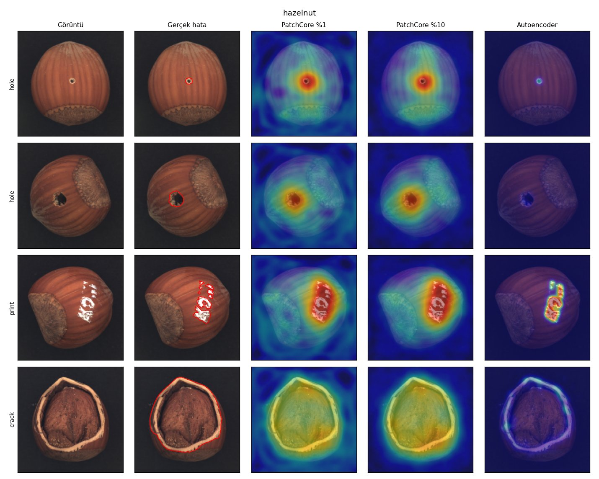
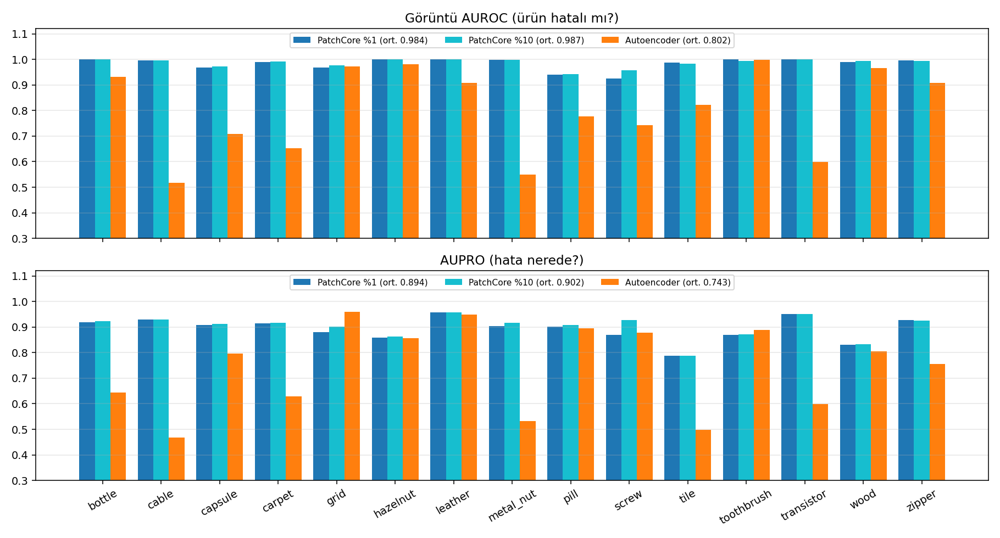
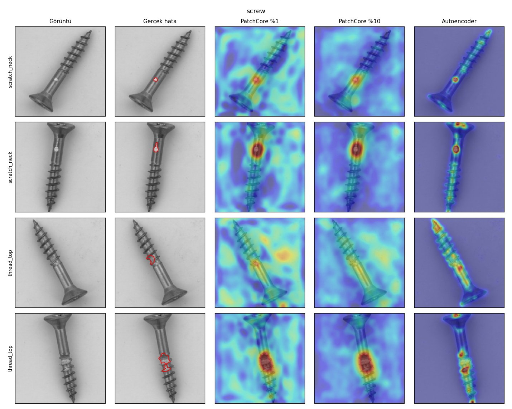

# Görsel Kalite Kontrol: Hatalı Ürün Tespiti

Üretim hattındaki ürün fotoğraflarında çizik, çatlak, kırık, leke gibi hataları bulan ve hatanın yerini
ısı haritasıyla gösteren bir sistem. Model **yalnızca sağlam ürünlerle** hazırlanıyor: fabrikada hatalı
örnek az ve her hata türünü önceden toplamak mümkün değil, o yüzden "normalden farklı olanı" bulmak gerekiyor.

İki yöntemi karşılaştırdım:

- **PatchCore** (Roth ve ark., 2022): ImageNet'te eğitilmiş bir ağdan (Wide ResNet-50) sağlam ürünlerin yama
  özelliklerini çıkarıp bir bellekte tutuyor. Test görüntüsündeki her yamanın bu belleğe uzaklığı hata puanı oluyor.
  Eğitim yok, bellek bir kategori için birkaç saniyede kuruluyor. Kodu sıfırdan yazdım (`src/patchcore.py`).
- **Autoencoder**: sağlam görüntülerle eğitilip görüntüyü geri üretmeyi öğreniyor; hatalı bölgeyi iyi geri
  üretemeyeceği varsayılıyor. Klasik yaklaşım, karşılaştırma için.



## Veri

[MVTec AD](https://www.mvtec.com/company/research/datasets/mvtec-ad): 15 ürün/doku türü, 3.629 sağlam eğitim görüntüsü,
1.725 test görüntüsü (hatalılar piksel düzeyinde etiketli). Her kategorinin sağlam eğitim görüntülerinin %10'unu
eşik seçimi için ayırdım; eşik de sadece sağlam görüntülere bakılarak seçiliyor.

## Sonuçlar

15 kategorinin ortalaması:

| Yöntem | Görüntü AUROC | Piksel AUROC | AUPRO | Hata yakalama | Yanlış alarm | Bellek | Süre |
| --- | --- | --- | --- | --- | --- | --- | --- |
| **PatchCore (%1 bellek)** | **0,984** | **0,977** | **0,894** | %91,3 | %6,9 | 3,3 MB | 19 ms |
| PatchCore (%10 bellek) | 0,987 | 0,979 | 0,902 | %94,0 | %9,2 | 33,4 MB | 21 ms |
| Autoencoder | 0,802 | 0,877 | 0,743 | %47,0 | %11,5 | | 18 ms |

- **Görüntü AUROC:** ürünün hatalı olup olmadığını ne kadar iyi ayırdığı.
- **Piksel AUROC / AUPRO:** hatanın yerini ne kadar doğru bulduğu. AUPRO her hatalı bölgeyi eşit sayıyor;
  küçük bir çizik de büyük bir kırık kadar önemli. Piksel AUROC büyük hataları fazla ödüllendirdiği için ikisine de baktım.
- **Hata yakalama / yanlış alarm:** sağlam doğrulama görüntülerinden seçilen eşikle, test setinde.
- **Süre:** RTX 5070 Ti, 16'lık gruplarla görüntü başına.

Bellek %1'den %10'a çıkınca (10 kat büyük) sonuçlar çok az değişiyor, bu yüzden servis %1'lik bellekleri kullanıyor.
Makalede %1 bellekle görüntü AUROC 0,990 ve piksel AUROC 0,980 civarında. Aradaki küçük farkın sebebi büyük ihtimalle
makaledeki komşuluğa göre puan yeniden ağırlıklandırmasını yapmamam.



### Kategori bazında

| Kategori | PatchCore görüntü | PatchCore piksel | PatchCore AUPRO | AE görüntü | AE AUPRO |
| --- | --- | --- | --- | --- | --- |
| bottle | 1,000 | 0,983 | 0,919 | 0,932 | 0,644 |
| cable | 0,997 | 0,984 | 0,930 | 0,517 | 0,467 |
| capsule | 0,969 | 0,987 | 0,907 | 0,708 | 0,796 |
| carpet | 0,990 | 0,988 | 0,914 | 0,652 | 0,628 |
| grid | 0,969 | 0,968 | 0,879 | 0,972 | 0,959 |
| hazelnut | 1,000 | 0,984 | 0,859 | 0,980 | 0,856 |
| leather | 1,000 | 0,990 | 0,957 | 0,907 | 0,950 |
| metal_nut | 0,998 | 0,983 | 0,903 | 0,550 | 0,533 |
| pill | 0,939 | 0,976 | 0,901 | 0,777 | 0,894 |
| screw | 0,925 | 0,974 | 0,870 | 0,743 | 0,877 |
| tile | 0,988 | 0,953 | 0,788 | 0,821 | 0,498 |
| toothbrush | 1,000 | 0,987 | 0,870 | 0,997 | 0,888 |
| transistor | 1,000 | 0,973 | 0,950 | 0,598 | 0,600 |
| wood | 0,990 | 0,936 | 0,830 | 0,967 | 0,804 |
| zipper | 0,997 | 0,982 | 0,928 | 0,907 | 0,755 |

### Gözlemler

- **Autoencoder neden kötü?** Hatayı da geri üretmeyi öğreniyor (özellikle metal_nut, cable, transistor gibi
  karmaşık nesnelerde) ya da sağlam ama detaylı bölgeleri geri üretemeyip yanlış alarm veriyor. Grid gibi düzenli
  dokularda ise iyi çalışıyor, hatta PatchCore'u geçiyor.
- **Zorlandığı yerler:** screw (vida her görüntüde farklı açıda duruyor, hatalar çok küçük) ve pill. Screw'da eşikle
  hataların ancak %55'i yakalanıyor; AUROC yüksek olsa da sağlam ve hatalı puanlar birbirine yakın.
- **Eşik sorunu:** Eşik, kategoriye göre 6 ile 39 arası sağlam doğrulama görüntüsünün en yüksek puanından seçiliyor. Carpet'te bu az geldi ve test setindeki
  sağlam halıların %43'ü yanlış alarm verdi. Gerçek bir hatta eşiğin çok daha fazla sağlam görüntüyle ayarlanması gerekir.

Her kategori için örnekler: [`reports/figures/kategoriler/`](reports/figures/kategoriler/)



## Demo ve API

```bash
python demo.py                 # http://127.0.0.1:7860, görüntü yükleyip sonucu görme
uvicorn api.app:app            # http://127.0.0.1:8000/docs
```

| Uç nokta | Açıklama |
| --- | --- |
| `GET /kategoriler` | Modeli olan ürün türleri |
| `POST /kontrol/{kategori}` | Görüntü yükle, karar ve puan dön |
| `POST /kontrol/{kategori}/harita` | Isı haritası bindirilmiş PNG dön |

```bash
curl -F "dosya=@ornekler/metal_nut__bent.png" http://127.0.0.1:8000/kontrol/metal_nut
```
```json
{"kategori": "metal_nut", "puan": 1.807, "esik": 1.381, "hatali": true, "hata_alani_orani": 0.0916}
```

Docker ile (CPU'da çalışıyor):

```bash
docker build -t kalite-kontrol .
docker run -p 8000:8000 kalite-kontrol
```

## Çalıştırma

```bash
python -m venv .venv
.venv\Scripts\activate         # Linux/macOS: source .venv/bin/activate
pip install -r requirements.txt
```

`models/patchcore/` altında 15 kategorinin bellekleri hazır, demo ve API için veri indirmek gerekmiyor.
Sonuçları baştan üretmek için MVTec AD'yi indirip `data/mvtec_ad/` altına açın:

```bash
python -m src.degerlendir      # 15 kategori, üç yöntem; RTX 5070 Ti'de ~15 dakika
python -m src.grafikler        # özet grafik
pytest                         # API testleri
```

## Klasör yapısı

```
src/
  veri.py          MVTec AD okuma ve dönüşümler
  patchcore.py     özellik çıkarma, coreset seçimi, puanlama
  autoencoder.py   karşılaştırma modeli
  metrikler.py     görüntü/piksel AUROC, AUPRO
  degerlendir.py   eğitim, test, sonuç tabloları ve örnek görseller
  cikarim.py       kayıtlı modellerle tek görüntü kontrolü
api/app.py         FastAPI servisi
demo.py            Gradio arayüzü
models/patchcore/  kategori başına bellek ve eşik (float16)
ornekler/          demo ve testler için birkaç test görüntüsü
reports/           sonuçlar ve grafikler
```

## Kaynaklar

- K. Roth, L. Pemula, J. Zepeda, B. Schölkopf, T. Brox, P. Gehler. *Towards Total Recall in Industrial Anomaly Detection.* CVPR 2022.
- P. Bergmann, M. Fauser, D. Sattlegger, C. Steger. *MVTec AD — A Comprehensive Real-World Dataset for Unsupervised Anomaly Detection.* CVPR 2019.

`ornekler/` klasöründeki görüntüler MVTec AD'den alınmıştır ve veri seti gibi
[CC BY-NC-SA 4.0](https://creativecommons.org/licenses/by-nc-sa/4.0/) lisanslıdır (ticari kullanım yok).

## Yazar

Batın Dikilitaş, Kocaeli Üniversitesi Yapay Zeka ve Makine Öğrenmesi
